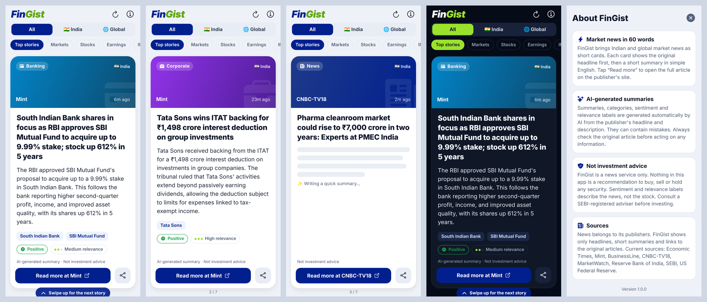

# FinGist app (iOS + Android)

React Native app built with Expo. It shows the live news feed from the FinGist backend as full-screen cards that you swipe up and down.



## Try it on your phone (Expo Go)
1. Install **Expo Go** from the App Store or Play Store.
2. On your Mac:
   ```bash
   cd app
   npm install
   npx expo start
   ```
3. Scan the QR code: on iPhone with the Camera app, on Android from inside Expo Go.
   The phone and the Mac must be on the same Wi-Fi network. If they are not, run `npx expo start --tunnel`.

The app reads news from `extra.apiUrl` in `app.json` (`https://fingist-api.fingist-sandip.workers.dev`).
For a different server, run with `EXPO_PUBLIC_API_URL=https://... npx expo start`.

## What's in it
| File | Purpose |
|---|---|
| `App.tsx` | Providers, offline cache (saved stories for 24h), splash screen |
| `src/components/FeedScreen.tsx` | Header, filters, swipe pager, refresh, "new stories" pill, empty/error states |
| `src/components/NewsCard.tsx` | One card: category banner, headline, summary, tickers, sentiment/relevance, Read more, share |
| `src/components/FilterBar.tsx` | All / India / Global and category chips |
| `src/components/AboutSheet.tsx` | About, AI disclaimer, not-investment-advice, sources |
| `src/components/Pager*.tsx` | Vertical pager (native) and a browser fallback used only for previews |
| `src/theme.ts` | Colours (light/dark), category icons and colours, labels |
| `assets/` | App icon, Android adaptive icon, splash (made from `../assets/brand`) |

## Checks
```bash
npx tsc --noEmit
npx expo export --platform ios --platform android   # bundles must build without errors
```

## Notes
- Bundle ID / package: `com.sandippatel.fingist`. It cannot be changed after the first store upload,
  so change it in `app.json` now if you prefer another (for example a company domain).
- Store builds will be made with EAS Build in Phase 5.
